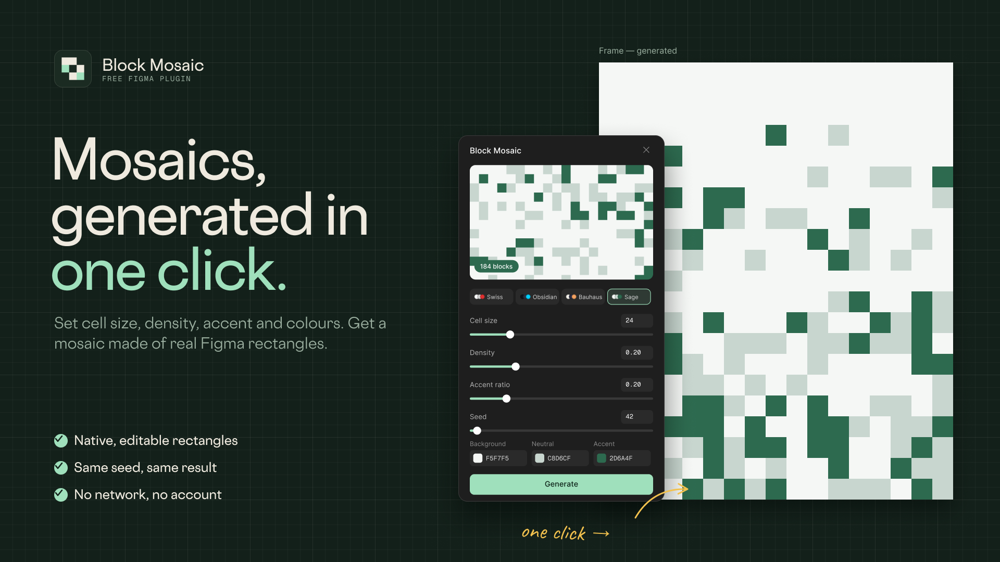
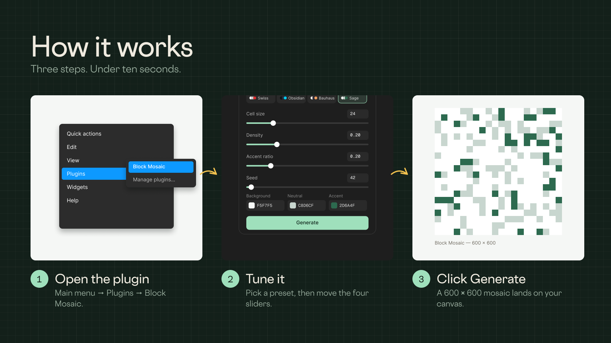
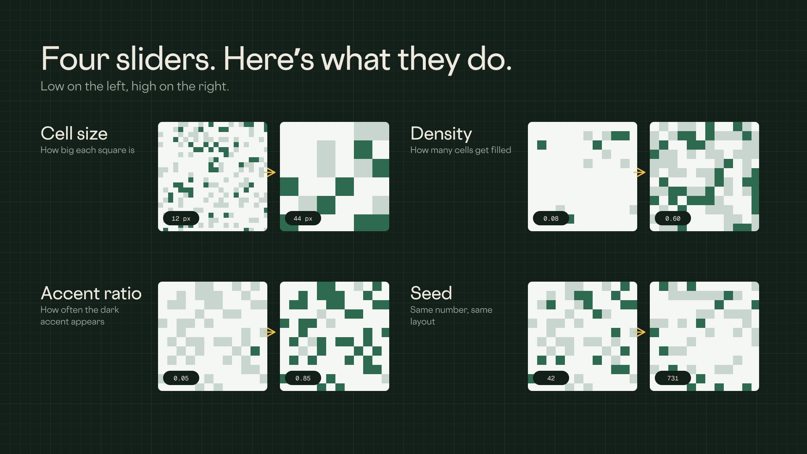
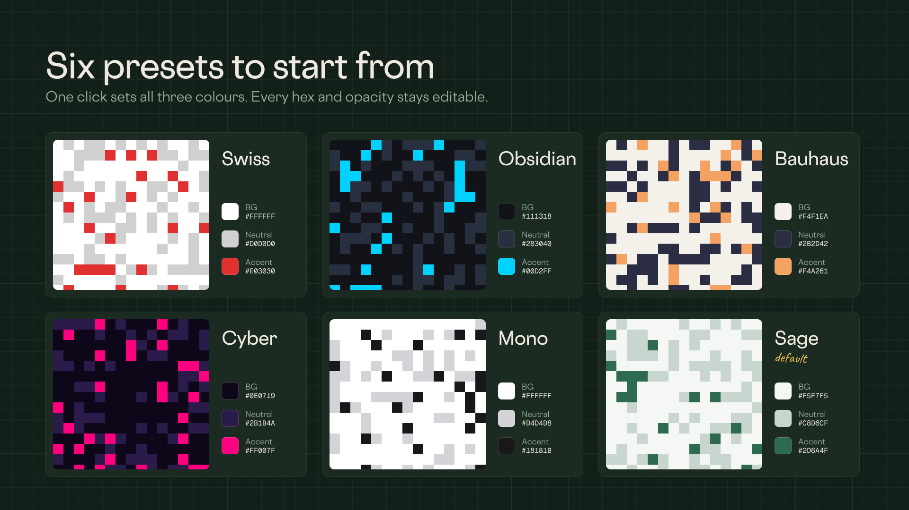
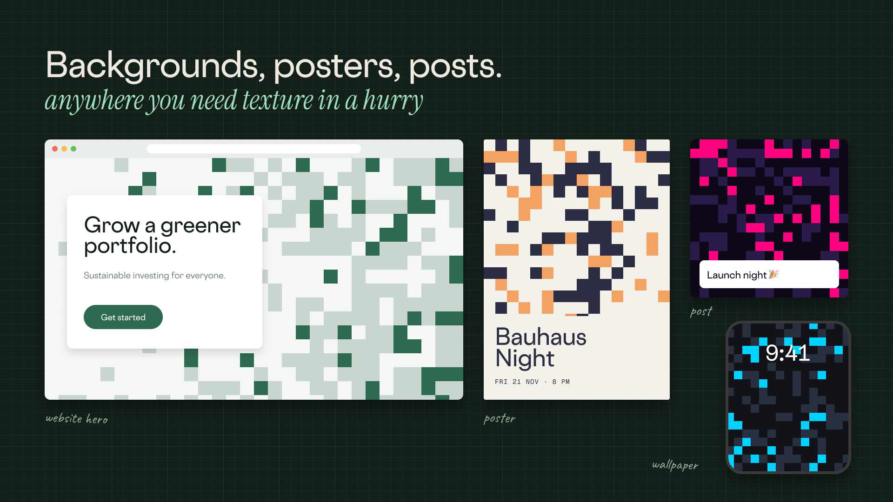

# Block Mosaic

Block Mosaic is a no-network Figma plugin that generates deterministic geometric mosaics. Adjust cell size, density, accent balance, colors, and seed; then generate a new frame or update a mosaic created earlier by the plugin.



<table>
  <tr>
    <td></td>
    <td></td>
  </tr>
  <tr>
    <td></td>
    <td></td>
  </tr>
</table>

## Features

- Live updates directly on the selected Figma canvas frame
- Repeatable results from a numeric seed
- Adjustable cell size, fill density, and accent ratio
- Background, neutral, and accent colors
- Non-destructive editing: ordinary selected layers are never cleared
- Select a previously generated Block Mosaic frame to update it in place
- No accounts, tracking, or network access
- No runtime or build dependencies

## Run locally in Figma

1. Install and open the Figma desktop app.
2. Open any Figma Design file.
3. Go to **Plugins → Development → Import plugin from manifest…**.
4. Choose this repository's `manifest.json`.
5. Run **Block Mosaic** from **Plugins → Development**.

If Figma asks you to register the plugin instead of accepting the local placeholder ID, create a new Figma Design plugin with **Custom UI**, then copy the numeric ID Figma creates into the `id` field of `manifest.json`.

## How it works

With no Block Mosaic frame selected, **Generate** creates a 600 × 600 frame in the center of the viewport. After that, changing a slider, numeric value, color, opacity, or the randomizer updates the selected mosaic directly on the canvas. Select a frame created by this plugin and reopen it—either from the plugin menu or its **Edit mosaic** relaunch button—to load and edit its saved settings. Manually resizing the generated frame is supported; the next update uses its current dimensions.

## Project files

| File | Purpose |
| --- | --- |
| `manifest.json` | Figma plugin metadata and permissions |
| `code.js` | Plugin controller and mosaic generator |
| `ui.html` | Self-contained plugin interface and live preview |
| `assets/` | Community icon, cover, and GitHub preview |
| `community/LISTING.md` | Ready-to-paste Community listing copy and checklist |
| `scripts/validate.mjs` | Dependency-free project validation |
| `tests/controller-smoke.mjs` | Mock-Figma create/update safety test |

The original TXT exports are kept locally and ignored by Git so the repository contains only the publishable project.

## Validate

With Node.js 20 or newer installed:

```sh
npm run validate
```

GitHub Actions runs the same validation on every push and pull request.

## Publishing

Follow [PUBLISHING.md](PUBLISHING.md) for the final Figma Community and GitHub steps. Figma assigns the permanent numeric plugin ID; no repository generator can pre-assign it.

## Privacy

Block Mosaic works entirely inside Figma. It makes no network requests and does not collect, transmit, or sell user data. See [PRIVACY.md](PRIVACY.md).

## License

MIT — see [LICENSE](LICENSE).
